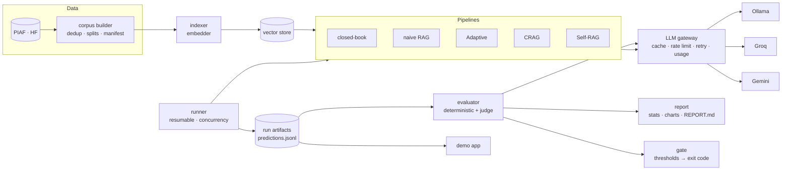

# ragbench-fr — Spécifications fonctionnelles et techniques

> **Statut :** v0.1, brouillon à discuter
> **Auteur :** Ahmed Aziz Ben Ayed
> **Usage :** document de référence du projet. Chaque ticket d'implémentation (voir §15) s'appuie dessus. Les décisions marquées ❓ sont à trancher avant le ticket concerné ; celles marquées ✅ sont proposées et considérées comme acquises sauf objection.

---

## 1. Contexte et objectifs

### 1.1 Problème

Les architectures RAG « agentiques » (Adaptive RAG, Corrective RAG, Self-RAG) promettent moins d'hallucinations que le RAG classique, au prix de plus d'appels LLM, de latence et de complexité. En pratique, les équipes les adoptent souvent **sans mesurer** ce qu'elles apportent, et presque toutes les comparaisons publiées portent sur des données **en anglais**.

### 1.2 Ce que le projet livre

Un **banc d'évaluation reproductible**, en français, qui :

1. exécute plusieurs architectures RAG sur **les mêmes données, le même retriever et le même modèle de génération** (seule l'architecture varie) ;
2. mesure la qualité des réponses, de la récupération et le coût ;
3. publie des résultats avec intervalles de confiance ;
4. sert de **quality gate en CI** : un changement qui dégrade la qualité fait échouer le build ;
5. propose une **démo publique** pour explorer les résultats question par question.

### 1.3 Critères de succès

| # | Critère | Mesure |
|---|---|---|
| S1 | Résultats exploitables | Tableau comparatif des 5 pipelines avec IC 95 % sur ≥ 200 questions de test |
| S2 | Reproductibilité | Un `make reproduce` (ou équivalent) relance l'éval et retrouve les mêmes chiffres à partir du cache |
| S3 | Juge LLM validé | Accord juge/humain mesuré (Cohen's κ) sur un échantillon annoté à la main |
| S4 | Quality gate | La CI échoue sur une régression volontaire (test du gate lui-même) |
| S5 | Coût nul | Aucun service payant ; respect des quotas gratuits |
| S6 | Qualité d'ingénierie | Typage strict, couverture ≥ 80 % sur le cœur, CI verte, ADR documentés |

### 1.4 Hors périmètre

- Fine-tuning de modèles.
- Interface d'administration, comptes utilisateurs, multi-tenant.
- Benchmark de bases vectorielles ou de modèles d'embedding (un seul choix, fixé et justifié).
- Mise en production d'un assistant RAG : c'est un **outil d'évaluation**, pas un produit.

---

## 2. Utilisateurs et cas d'usage

| Utilisateur | Besoin | Cas d'usage |
|---|---|---|
| **Ingénieur IA** (utilisateur principal) | Choisir une architecture RAG sur des preuves | UC1 lancer un benchmark · UC2 comparer des runs · UC3 inspecter une question (trace complète) |
| **Mainteneur** | Ne pas dégrader la qualité en modifiant prompts ou code | UC4 quality gate en CI |
| **Visiteur / recruteur** | Comprendre le projet en 2 minutes | UC5 démo en ligne · UC6 lire le rapport de résultats |

---

## 3. Exigences fonctionnelles

| ID | Exigence |
|---|---|
| **FR-1** | Construire un corpus et un jeu de questions à partir de PIAF, avec des splits figés (`dev`, `test`, `ci`) et un manifeste (hash) garantissant qu'ils ne changent pas entre deux runs. |
| **FR-2** | Indexer le corpus (embeddings) et exposer une recherche top-k. |
| **FR-3** | Exécuter 5 pipelines derrière un contrat commun (§7) : *closed-book*, *naive RAG*, *Adaptive RAG*, *CRAG*, *Self-RAG*. |
| **FR-4** | Pour chaque question et chaque pipeline, enregistrer : réponse, documents récupérés, **trace des étapes** (nœuds traversés, décisions de routage, nombre de corrections), appels LLM, tokens et latence. |
| **FR-5** | Calculer les métriques déterministes (récupération, EM/F1) et les métriques jugées par LLM (§8). |
| **FR-6** | Produire un rapport : tableau comparatif avec IC 95 %, tests de significativité appariés, graphiques qualité/coût. |
| **FR-7** | Fournir une CLI : `build-corpus`, `build-index`, `run`, `report`, `gate`. |
| **FR-8** | Reprendre un run interrompu sans refaire les appels déjà effectués (cache + checkpoints). |
| **FR-9** | Quality gate : comparer un run CI à des seuils versionnés et renvoyer un code de sortie non nul en cas de régression. |
| **FR-10** | Démo web : parcourir les questions de test, voir côte à côte les réponses et traces des 5 pipelines, et leurs scores. |

---

## 4. Exigences non fonctionnelles

| ID | Exigence | Cible |
|---|---|---|
| **NFR-1 Reproductibilité** | Mêmes entrées → mêmes sorties : température 0, seeds fixées, versions des modèles épinglées dans la config du run, cache des réponses LLM indexé par (fournisseur, modèle, prompt, paramètres). | Rerun à partir du cache : résultats identiques à la décimale près |
| **NFR-2 Coût** | 0 € : modèles locaux (Ollama) et offres gratuites uniquement. | — |
| **NFR-3 Quotas** | Limiteur de débit par fournisseur (RPM/RPD configurables), retry avec backoff exponentiel et jitter sur 429/5xx, arrêt propre quand le quota journalier est atteint, reprise le lendemain sans perte. | 0 appel perdu |
| **NFR-4 Performance** | Run complet faisable sur un laptop (nuit) ; gate CI < 10 min. | — |
| **NFR-5 Observabilité** | Logs structurés (JSON), comptage des appels/tokens par pipeline et par étape, traces par question. | — |
| **NFR-6 Qualité de code** | Typage `mypy --strict` sur `src/`, `ruff` (lint + format), couverture ≥ 80 % hors adaptateurs fournisseurs, aucun appel réseau dans les tests unitaires. | CI bloquante |
| **NFR-7 Sécurité** | Aucune clé dans le code ou l'historique ; `.env` ignoré ; secrets CI via GitHub Secrets ; la CI ne s'exécute pas avec secrets sur les PR de forks. | — |
| **NFR-8 Documentation** | README orienté résultats, ADR pour chaque décision structurante, docstrings sur les interfaces publiques. | — |

---

## 5. Données

### 5.1 Source ✅

**PIAF** (`AgentPublic/piaf` sur Hugging Face) : questions-réponses extractives en français construites sur Wikipédia, **licence MIT**, environ 3 800 questions, accès libre.

Format : `(contexte, question, réponse extractive + offset)`.

### 5.2 Construction du corpus

- **Corpus** = ensemble des contextes uniques (déduplication par hash du texte normalisé), chacun avec un `doc_id` stable.
- **Vérité terrain de récupération** : pour chaque question, le `doc_id` de son contexte d'origine. C'est ce qui rend les métriques de récupération **déterministes, sans LLM**.
- **Chunking** ❓ : les contextes PIAF sont des paragraphes déjà courts. Proposition : **un contexte = un chunk** (pas de découpage), pour ne pas introduire une variable de plus. Le découpage reste une extension possible.

### 5.3 Splits (figés, seed fixe)

| Split | Taille | Usage |
|---|---|---|
| `dev` | ~100 questions | itérer sur les prompts sans « sur-apprendre » le test |
| `test` | 200–300 questions | résultats publiés |
| `ci` | 25–30 questions (sous-ensemble de `test`) | quality gate |

Un fichier `data/manifest.json` contient les IDs et les hash de chaque split ; un test vérifie qu'ils ne changent pas.

### 5.4 Risque de contamination

Wikipédia fait partie des données d'entraînement de tous les LLM : un modèle peut répondre **de mémoire**, sans récupération. Le pipeline **closed-book** (sans RAG) sert précisément à mesurer ce biais. L'apport réel d'une architecture se lit **par rapport à cette ligne de base**, et le rapport doit le dire explicitement.

---

## 6. Variables contrôlées (protocole expérimental)

Pour que la comparaison soit honnête, **seule l'architecture varie**. Sont fixés pour tous les pipelines d'un même run :

- le corpus, l'index et le modèle d'embedding ;
- le `k` de récupération (proposition : k = 5) ;
- le modèle de génération, la température (0) et le budget max de tokens ;
- le juge (modèle et prompt) ;
- les plafonds d'itérations des boucles agentiques (§7).

Toute variation (autre générateur, autre `k`) fait l'objet d'un **run distinct**, identifié dans sa config.

---

## 7. Pipelines évalués

Contrat commun (pseudo-code) :

```python
class Pipeline(Protocol):
    name: str
    def answer(self, question: str) -> PipelineResult: ...

@dataclass(frozen=True)
class PipelineResult:
    answer: str
    retrieved: list[RetrievedDoc]      # doc_id, score, rang
    trace: list[TraceStep]             # nœud, décision, durée, appels LLM
    llm_calls: int
    tokens_in: int
    tokens_out: int
    latency_ms: float
```

| Pipeline | Comportement spécifié | Plafonds |
|---|---|---|
| **closed-book** | Le LLM répond sans aucun contexte. Mesure la mémorisation. | 1 appel |
| **naive RAG** | Récupérer top-k → générer à partir du contexte. | 1 appel |
| **Adaptive RAG** | Un routeur classe la question (répondable directement / nécessite récupération / reformulation) puis choisit la branche. | ≤ 3 appels |
| **CRAG** | Récupérer → **noter la pertinence des documents en un seul appel** → si aucun document pertinent : reformuler la requête et récupérer à nouveau (une fois) → générer. | 1 reformulation max |
| **Self-RAG** | Générer → noter (fondé sur le contexte ? répond à la question ?) → régénérer ou reformuler si nécessaire. | 2 corrections max |

**Orchestration ✅ :** LangGraph pour les pipelines agentiques (même outil que dans PriceWatch, graphe explicite et inspectable). Les deux pipelines simples sont du Python pur. Tous respectent le même contrat.

**Prompts :** fichiers versionnés (`prompts/*.md` ou `.jinja`), jamais en dur dans le code ; leur hash fait partie de l'identité du run et de la clé de cache.

---

## 8. Métriques

### 8.1 Déterministes (sans LLM) — utilisables en CI sans quota

| Métrique | Définition |
|---|---|
| Recall@k, MRR | Le document d'origine est-il dans le top-k, et à quel rang ? |
| Exact Match, F1 lexical | Comparaison avec la réponse de référence, après **normalisation française** (minuscules, accents, articles « le/la/les/l'/un/une/des », ponctuation) |

⚠️ Les réponses PIAF sont **extractives et courtes** ; un LLM génère des phrases. L'EM sera donc sévère : on retient le F1 et une métrique *« la réponse de référence est contenue dans la réponse »* comme indicateurs lexicaux, et la **justesse jugée par LLM** comme métrique principale.

### 8.2 Jugées par LLM

Un **seul appel juge par réponse**, retournant un JSON validé (Pydantic) :

| Score | Question posée au juge | Échelle |
|---|---|---|
| `faithfulness` | Chaque affirmation de la réponse est-elle soutenue par les documents fournis ? | 0–1 (proportion d'affirmations soutenues) |
| `correctness` | La réponse est-elle correcte par rapport à la référence ? | 0 / 0.5 / 1 |
| `relevance` | La réponse traite-t-elle la question posée ? | 0 / 0.5 / 1 |

+ une justification courte, conservée pour l'audit.

**Biais du juge et mitigations :**
- **juge d'une famille de modèles différente** du générateur (biais d'auto-préférence) ;
- rubrique explicite avec exemples dans le prompt ;
- **validation** : 50 réponses annotées à la main → accord juge/humain (Cohen's κ, et accord brut) publié dans le rapport. Si κ < 0,6, on revoit le prompt du juge avant de publier.

### 8.3 Coût et latence

Appels LLM, tokens entrée/sortie, latence p50/p95 par pipeline. Le rapport présente **qualité vs coût** (graphique), car c'est le vrai arbitrage.

### 8.4 Statistiques

- Intervalles de confiance à 95 % par **bootstrap** (≥ 1 000 rééchantillonnages).
- Comparaisons **appariées** (mêmes questions) : bootstrap apparié sur la différence de scores ; test de McNemar pour les métriques binaires.
- Le rapport n'annonce une amélioration que si elle est significative.

---

## 9. Architecture technique



### 9.1 Composants et interfaces clés

| Module | Responsabilité | Interface |
|---|---|---|
| `data` | Charger PIAF, dédupliquer, créer les splits, écrire le manifeste | fonctions pures + CLI |
| `index` | Embeddings (batch, cache disque), stockage, recherche top-k | `Embedder`, `VectorStore` (Protocol) |
| `llm` | **Passerelle unique** vers tous les fournisseurs : sortie structurée, cache, limiteur, retry, comptage | `LLMClient` (Protocol) |
| `pipelines` | Les 5 architectures | `Pipeline` (Protocol) |
| `eval` | Métriques, juge, statistiques | `Metric`, `Judge` |
| `runner` | Exécution parallèle bornée, reprise, artefacts | — |
| `report` / `gate` | Rapport Markdown + graphiques ; comparaison aux seuils | — |
| `app` | Démo | lit uniquement les artefacts |

**Principe directeur :** aucun module métier ne parle directement à un SDK fournisseur ; tout passe par `LLMClient`. C'est ce qui rend le cache, les quotas, le comptage et les tests (faux client déterministe) possibles partout.

### 9.2 Cache des appels LLM ✅

- SQLite (fichier local), clé = hash(fournisseur, modèle, version du prompt, messages, paramètres).
- Partagé par le runner, le juge et la CI (restauré via `actions/cache`).
- Conséquence : relancer un run ou le rapport ne coûte **aucun appel** ; seuls les éléments modifiés sont recalculés.

### 9.3 Artefacts d'un run

```
results/runs/<run_id>/
  config.yaml          # config complète résolue (modèles, k, prompts + hash, seed)
  predictions.jsonl    # une ligne par (question, pipeline) : réponse, docs, trace, usage
  scores.jsonl         # métriques par (question, pipeline)
  summary.json         # agrégats + IC
results/REPORT.md      # rapport publié (versionné)
```

Les runs « officiels » sont versionnés dans le repo (ils alimentent la démo et le README) ; les runs d'exploration sont ignorés par git.

---

## 10. Décisions d'architecture à discuter

Chaque décision sera formalisée en ADR (`docs/adr/NNN-titre.md`) une fois tranchée.

### D1 — Base vectorielle ❓

| Option | Pour | Contre |
|---|---|---|
| **A. pgvector** (+ implémentation en mémoire pour la démo) | Cohérent avec ton expérience PriceWatch ; recherche hybride plein texte français native ; service PostgreSQL facile en CI (déjà fait) | La démo (Hugging Face Spaces) ne peut pas héberger PostgreSQL → il faut une 2ᵉ implémentation |
| **B. Index en mémoire uniquement** (NumPy, éventuellement FAISS) | Un seul code, zéro service, idéal pour un corpus de quelques milliers de paragraphes | Moins impressionnant techniquement ; pas de plein texte natif |
| **C. LanceDB** (embarqué) | Une seule implémentation partout, persistance sur disque | Nouvelle techno à justifier ; support du plein texte français à vérifier |

**Recommandation : A.** Le contrat `VectorStore` a de toute façon deux implémentations naturelles : pgvector pour le benchmark, en mémoire pour la démo et les tests unitaires. Ça démontre aussi le principe d'inversion de dépendance, que tu pourras expliquer en entretien.

### D2 — Modèle d'embedding ✅ (à confirmer)

`intfloat/multilingual-e5-base` via `sentence-transformers`, sur CPU.
- Multilingue, bon en français, taille raisonnable pour la CI.
- ⚠️ Exige les préfixes `query: ` / `passage: ` : erreur classique à couvrir par un test.
- `nomic-embed-text` (utilisé dans PriceWatch) est surtout entraîné sur de l'anglais : moins adapté ici.
- Alternative plus forte mais plus lourde : `BAAI/bge-m3`.

### D3 — Fournisseurs LLM et rôles ❓

| Rôle | Proposition | Raison |
|---|---|---|
| **Générateur** | Groq (Llama 8B) par défaut, Ollama en option hors ligne | Rapide et gratuit ; Ollama garantit l'indépendance |
| **Juge** | Gemini Flash | Famille différente du générateur (biais d'auto-préférence) ; sortie JSON fiable |

Quotas gratuits indicatifs (octobre 2026, **à revérifier au moment du ticket**, ils changent souvent) : Gemini Flash ≈ 10 req/min et 500–1 500 req/jour ; Groq ≈ 30 req/min, quota journalier variable selon le modèle.

### D4 — Framework d'évaluation ❓

| Option | Pour | Contre |
|---|---|---|
| **A. Métriques maison** (+ comparaison ponctuelle avec RAGAS) | Contrôle total, prompts du juge en français, tu sais expliquer chaque chiffre | Plus de code |
| **B. RAGAS seul** | Rapide | Boîte noire ; prompts orientés anglais ; nombreux appels LLM par métrique (mauvais pour les quotas) |

**Recommandation : A.** Ce que tu veux pouvoir dire en entretien, c'est « j'ai conçu la métrique de fidélité et validé le juge », pas « j'ai appelé une librairie ».

### D5 — Stratégie du quality gate CI ✅

Deux niveaux :

1. **Sur chaque push / PR (sans quota) :** tests, lint, typage, et **métriques de récupération** sur le split `ci` (déterministes, embeddings calculés en CI).
2. **Sur `main` et manuellement :** éval LLM du split `ci` (25–30 questions) avec le cache restauré ; seuls les appels nouveaux (prompt ou code modifié) consomment du quota. Le gate échoue si un score passe sous `seuil − tolérance`.
3. **Run complet :** manuel (`workflow_dispatch`) ou en local, jamais à chaque push.

Les seuils sont dans un fichier versionné (`gate/thresholds.yaml`) : les relever devient une décision explicite visible dans une PR.

### D6 — Démo ❓

| Option | Description |
|---|---|
| **A. Explorateur de résultats** (recommandé) | Gradio sur Hugging Face Spaces, lit les artefacts du run officiel : choisir une question, voir les 5 réponses, traces et scores. Aucun appel LLM → aucun risque pour les quotas, toujours disponible. |
| **B. A + mode « live »** | Poser une question libre. Consomme le quota gratuit à chaque visiteur → nécessite une limite stricte. |

**Recommandation : A d'abord**, B en option plus tard, plafonnée.

### D7 — Outillage ✅

`uv` (dépendances + lockfile), Python **3.12**, `ruff`, `mypy --strict`, `pytest` (+ `pytest-cov`), `pre-commit`, `typer` (CLI), `pydantic` / `pydantic-settings` (config et sorties structurées), `structlog` (logs JSON), `matplotlib` (graphiques).

Tranché dans l'[ADR 0001](adr/0001-python-tooling.md) (T01). Chaque bibliothèque est ajoutée par le ticket qui l'utilise en premier.

### D8 — Langue du repo ✅

Proposition : **code, README et ADR en anglais** (portée internationale, cohérent avec ton GitHub) ; **données, prompts et rapport de résultats en français**, puisque c'est le sujet du projet. Ce document de spécification peut rester en français.

Tranché dans l'[ADR 0002](adr/0002-repository-language.md) (T01) : la proposition est retenue, et s'étend aux docstrings, à `CLAUDE.md` et aux messages de commit (en anglais).

### D9 — Nom du projet ✅

`ragbench-fr` (proposé), `rag-arena-fr`, `evalrag-fr`.

Retenu (T01) : dépôt et distribution `ragbench-fr`, package Python `ragbench`, commande `ragbench`.

---

## 11. Budget LLM (ordre de grandeur)

Hypothèse : split `test` de 250 questions.

| Poste | Appels / question | Total |
|---|---|---|
| Génération, 5 pipelines (moyenne incluant les boucles agentiques) | ≈ 8–10 | ≈ 2 000–2 500 |
| Juge (1 appel par réponse, 5 pipelines) | 5 | ≈ 1 250 |

- **Génération sur Groq** : ≈ 2 500 appels à ~30 req/min ≈ 1h30 de run.
- **Juge sur Gemini Flash** : ≈ 1 250 appels, soit **1 à 3 jours de quota gratuit** selon le modèle Flash → d'où le limiteur avec reprise automatique (NFR-3) et le cache.
- **Itérations suivantes** : quasi gratuites grâce au cache ; seuls les pipelines modifiés sont rejoués.

C'est cette contrainte qui justifie : un seul appel juge par réponse, la notation de tous les documents CRAG en un seul appel, et le split `dev` séparé.

---

## 12. Structure du repo (cible)

```
ragbench-fr/
├── pyproject.toml / uv.lock
├── src/ragbench/
│   ├── config.py            # settings (pydantic-settings) + config de run (YAML)
│   ├── data/                # piaf loader, corpus builder, splits, manifest
│   ├── index/               # embedder, VectorStore: memory + pgvector
│   ├── llm/                 # LLMClient, providers/, cache, rate limiter, usage
│   ├── pipelines/           # base contract, closed_book, naive, adaptive, crag, self_rag
│   ├── eval/                # metrics/, judge, stats
│   ├── runner.py
│   ├── report.py / gate.py
│   └── cli.py
├── prompts/                 # prompts versionnés
├── configs/                 # configs de runs (YAML)
├── data/manifest.json       # splits figés
├── gate/thresholds.yaml
├── results/                 # runs officiels + REPORT.md
├── app/                     # démo Gradio
├── tests/{unit,integration}/
├── docs/{specification.md, adr/}
├── .github/workflows/       # ci.yml, eval-gate.yml, full-run.yml
└── CLAUDE.md                # conventions pour les sessions Claude Code
```

---

## 13. Standards et « Definition of Done » d'un ticket

Un ticket est terminé quand :

1. le code respecte les interfaces de ce document (ou le document est mis à jour dans le même ticket) ;
2. `ruff`, `mypy --strict` et `pytest` passent ; la couverture du module ≥ 80 % ;
3. **aucun appel réseau dans les tests unitaires** (faux `LLMClient` / `Embedder` déterministes) ;
4. les erreurs sont gérées explicitement (pas de `except Exception: pass`), les logs sont structurés ;
5. la doc est à jour (README si comportement visible, ADR si décision) ;
6. commits atomiques, messages conventionnels (`feat:`, `fix:`, `test:`…), CI verte.

Le fichier `CLAUDE.md` du repo reprendra ces règles, pour que chaque session Claude Code les applique sans les répéter dans chaque prompt.

---

## 14. Risques

| Risque | Impact | Mitigation |
|---|---|---|
| Quotas gratuits modifiés ou épuisés | Run bloqué | Passerelle multi-fournisseurs, cache, reprise automatique, Ollama en secours |
| Contamination Wikipédia | Gains du RAG surestimés | Ligne de base closed-book, analysée dans le rapport |
| Juge biaisé ou incohérent | Conclusions fausses | Famille différente, rubrique, validation κ sur annotations humaines |
| Petit modèle générateur bruité | Différences non significatives | Température 0, IC bootstrap, tests appariés ; publier aussi les résultats non significatifs |
| EM trop sévère sur des réponses génératives | Métrique trompeuse | F1, « référence contenue », justesse jugée comme métrique principale |
| Dérive de périmètre | Projet jamais fini | Périmètre §1.4, livrable utile dès la fin de l'épique 4 |

---

## 15. Plan de livraison (épiques → tickets)

| Épique | Tickets | Dépend de |
|---|---|---|
| **E0 Fondations** | T01 squelette du repo (uv, ruff, mypy, pytest, pre-commit, CI lint+tests, CLAUDE.md) · T02 configuration (settings, config de run YAML, logs structurés) | — |
| **E1 Données** | T03 loader PIAF, corpus dédupliqué, splits figés, manifeste + tests d'intégrité | T02 |
| **E2 Indexation** | T04 embedder (préfixes e5, batch, cache disque) · T05 `VectorStore` + implémentation mémoire · T06 implémentation pgvector + tests d'intégration | T03 |
| **E3 Passerelle LLM** | T07 `LLMClient` + fournisseurs (Ollama, Groq, Gemini), sortie structurée · T08 cache SQLite, limiteur RPM/RPD, retry/backoff, comptage d'usage | T02 |
| **E4 Pipelines** | T09 contrat + closed-book + naive RAG · T10 Adaptive RAG · T11 CRAG · T12 Self-RAG | T05, T08 |
| **E5 Évaluation** | T13 métriques déterministes (récupération, EM/F1 FR) · T14 juge LLM + jeu annoté + κ · T15 runner (parallélisme borné, reprise, artefacts) + statistiques · T16 rapport (Markdown + graphiques) | T09 |
| **E6 CI & gate** | T17 gate (seuils, code de sortie, test du gate) + workflows (push / main / run complet) | T13, T15 |
| **E7 Démo & diffusion** | T18 démo Gradio + déploiement Hugging Face Spaces · T19 README orienté résultats, rapport final, article | T16 |

**Jalon intermédiaire :** à la fin de E4 + T13, tu as déjà un banc fonctionnel avec métriques déterministes. C'est publiable même si la suite prend du retard.

---

## 16. Questions à trancher avant de démarrer

1. **D1** base vectorielle : pgvector + mémoire (recommandé), mémoire seule, ou LanceDB ?
2. **D3** générateur par défaut : Groq (rapide) ou Ollama (local, plus lent) ?
3. **D6** démo : explorateur seul (recommandé) ou avec mode live ?
4. ~~**D8** langue du repo : anglais pour code et docs, français pour données et rapport ?~~ Tranché : voir [ADR 0002](adr/0002-repository-language.md).
5. ~~**D9** nom du projet ?~~ Tranché : `ragbench-fr`.
6. Taille du split `test` : 200, 250 ou 300 questions (compromis précision statistique / quota du juge) ?
